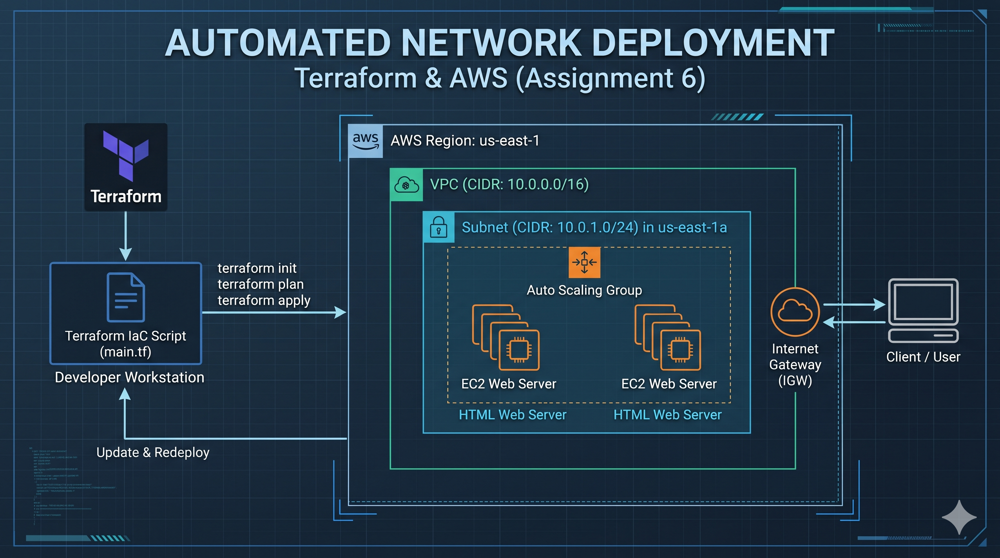

What is Terraform?
Terraform is an open-source Infrastructure as Code (IaC) tool created by HashiCorp.

Instead of manually logging into the AWS Console and clicking buttons to create VPCs, subnets, and servers (which is slow, error-prone, and hard to replicate), Terraform lets you define your entire cloud infrastructure as plain text files (main.tf) using HCL (HashiCorp Configuration Language).

Step 1: Initial Deployment

Click "Step 1: Initial Deployment"
Shows the green VPC tag: Assignment6-VPC
State badge: Apply complete! Resources: 2 added, 0 changed, 0 destroyed.
Streams live deployment packets from the Developer Workstation to AWS.
Step 2: Modify & Redeploy (In-Place Diff)

Click "Step 2: Modify & Redeploy"
Live updates the VPC tag to Assignment6-VPC-modified with an amber flash.
Shows the in-place diff card (- "Name" = "Assignment6-VPC", + "Name" = "Assignment6-VPC-modified") and Plan: 0 to add, 1 to change, 0 to destroy.
Simulates terraform apply terminal logs with in-place resource modification.
User-Controlled Traffic & Auto-Scaling / De-scaling

Drag the Traffic Slider or click preset buttons (Low (30/s), Moderate (150/s), Surge (480/s), Peak (850/s)):
Scale Out (Surge / High Traffic): Request packets stream faster through the Internet Gateway (IGW). When load crosses the threshold, the Auto Scaling Group triggers a scale-out event, spinning up new EC2 web nodes (up to 4 nodes) with real-time CloudWatch alarm notifications and terminal logs.
De-scale / Scale In (Subsided Traffic): When you lower the traffic slider back down, the ASG automatically triggers de-scaling, gracefully draining connections and terminating instances down to the base capacity (2 nodes).
EC2 Node HTTP Inspection (Port 80)

Click on any active EC2 Web Server node to open a simulated browser modal demonstrating http://10.0.1.x:80/index.html served by Apache HTTPD.

       [ main.tf ] (Desired State)
            │
            ▼
     ┌──────────────┐
     │  Terraform   │ ◄──── Reads Provider (AWS Plugins via API)
     │    Engine    │ ◄──── Compares with [ terraform.tfstate ] (Known State)
     └──────┬───────┘
            │
            ├──────────────► Calculates Diff (Plan: +Add, ~Change, -Destroy)
            │
            ▼
     ┌──────────────┐
     │   AWS Cloud  │ ◄──── Executes AWS REST APIs (VPC, Subnet, EC2, IGW)
     └──────────────┘

[CloudWatch Alarm] Metric "TrafficRate" breach: 480 RPS > 350 RPS
[EventBridge] Dispatching Webhook -> POST /iac/scale-out { desired_capacity: 3 }
[Terraform Engine] Updating main.tf: desired_capacity = 3
[Terraform] ~ update in-place: aws_autoscaling_group.web (2 => 3)
AWS API ec2:RunInstances: Launched i-03d8e571 (10.0.1.142:80). Cluster capacity: 3.
